# 9rayti · قرايتي

**Tutorat entre étudiants, partout en Tunisie.** Un étudiant qui a réussi une matière donne des cours en direct à d'autres étudiants, de son école ou d'ailleurs. La plateforme est la salle de cours : visio, PDF et replay restent au même endroit, ce qui protège l'étudiant (remboursé si le cours n'a pas lieu) et garde le tuteur sur 9rayti.

Projet Web, SUP'COM, encadré par Dr. Maroua Nouioua. **Objectif 3 : implémentation.**
Groupe 9rayti : Iheb Attia.

| | |
|---|---|
| **Démo en ligne** (sans installation, données simulées dans le navigateur) | https://iheb1234-afk.github.io/9rayti/ |
| **Code** | https://github.com/iheb1234-afk/9rayti |
| **Suivi des tâches** | [Issues](https://github.com/iheb1234-afk/9rayti/issues?q=is%3Aissue) et [jalon « Objectif 3 »](https://github.com/iheb1234-afk/9rayti/milestone/1) |
| **Documentation de l'API** (une fois lancée) | http://localhost:3000/api/docs |

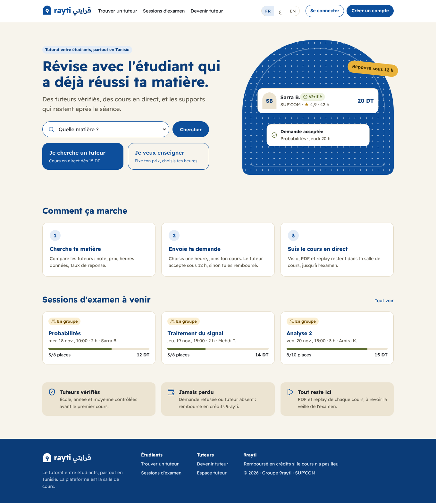

---

## Sommaire

1. [Lancer le projet](#1-lancer-le-projet)
2. [Choix des frameworks](#2-choix-des-frameworks)
3. [Fonctionnalités développées](#3-fonctionnalités-développées)
4. [Architecture](#4-architecture)
5. [Règles métier](#5-règles-métier)
6. [API REST](#6-api-rest)
7. [Qualité : tests, accessibilité, performance](#7-qualité--tests-accessibilité-performance)
8. [Méthode de travail (Git, tâches)](#8-méthode-de-travail)
9. [Captures](#9-captures)
10. [Limites et suite](#10-limites-et-suite)

---

## 1. Lancer le projet

**Prérequis :** Node.js 20.19+ ou 22 (LTS) et npm. Rien d'autre : la base PostgreSQL est fournie par `npm run db:local` (pas besoin de Docker ni d'installer PostgreSQL).

```bash
git clone https://github.com/iheb1234-afk/9rayti.git
cd 9rayti
```

**Terminal 1 — base de données PostgreSQL** (port 5433)

```bash
cd backend
npm install
npm run db:local          # télécharge et démarre un PostgreSQL embarqué (dossier backend/.pgdata)
```

> Alternative : `docker compose up -d` à la racine, ou n'importe quel PostgreSQL en réglant `DATABASE_URL` (voir `backend/.env.example`).
> Sous Linux, `db:local` refuse de tourner en root (sécurité de PostgreSQL) : lancer avec un utilisateur normal.

**Terminal 2 — API NestJS** (port 3000)

```bash
cd backend
npm run start:dev         # crée les tables et les données de démonstration au premier démarrage
```

**Terminal 3 — application Angular** (port 4200)

```bash
cd frontend
npm install
npm start                 # puis ouvrir http://localhost:4200
```

**Comptes de démonstration** (mot de passe `demo1234` pour tous, aussi accessibles en un clic sur la page de connexion) :

| Rôle | E-mail | Pour voir |
|---|---|---|
| Étudiante | `yasmine@9rayti.tn` | demandes dans tous les états, crédits, salle de cours, avis |
| Étudiant | `omar@9rayti.tn` | paiement par carte, session d'examen réservée |
| Tutrice | `sarra@9rayti.tn` | demandes à accepter, cours, heures libres, gains |
| Tuteurs | `youssef@`, `amira@` (profil « Nouveau »), `mehdi@9rayti.tn` | |
| Tutrice en attente | `nour@9rayti.tn` | profil pas encore vérifié |
| Admin | `admin@9rayti.tn` | validation des tuteurs, activité |

Les dates des données de démonstration sont calculées à partir du jour du lancement : il y a toujours des cours à venir.

**Autres commandes**

```bash
cd backend  && npm test            # 17 tests unitaires (machine à états, délais, argent)
cd backend  && npm run test:e2e    # 5 tests de bout en bout (base PostgreSQL lancée)
cd frontend && npm run test:ci     # 9 tests Angular (Chrome headless)
cd frontend && npm run build:demo  # build GitHub Pages (mode démo, sans serveur)
```

---

## 2. Choix des frameworks

| Couche | Choix | Pourquoi |
|---|---|---|
| Front | **Angular 20** (standalone components, signals, nouveau control flow `@if/@for`) | Imposé par le cours, et adapté : application à plusieurs espaces (étudiant, tuteur, admin) avec formulaires, routes protégées et beaucoup d'état. Angular fournit tout cela de base (routeur, formulaires réactifs, HttpClient, intercepteurs) sans assembler dix bibliothèques. Les **signals** rendent l'état (session, filtres, onglets) simple et performant. |
| Traductions | **Transloco** | Changement de langue **à chaud** (sans recharger ni builder une version par langue, contrairement à l'i18n native d'Angular), indispensable pour basculer FR / AR / EN et le sens RTL depuis l'en-tête. |
| API | **NestJS 11** (TypeScript) | Même langage et mêmes idées qu'Angular (modules, décorateurs, injection de dépendances) : un seul langage pour tout le projet. Validation des entrées par DTO, gardes par rôle, tâches planifiées (expiration 12 h, versement 24 h) et documentation **Swagger** générée automatiquement. |
| Base | **PostgreSQL** + **TypeORM** | Base relationnelle SQL demandée depuis l'Objectif 1. Les **transactions et verrous** de PostgreSQL empêchent deux étudiants de réserver la même heure ; TypeORM traduit le modèle de données de l'Objectif 2 en entités. |
| Visio | **Jitsi Meet** (intégré en iframe) | Gratuit, chiffré, sans compte pour l'étudiant, une salle privée par cours générée par le serveur. |
| Style | **SCSS** + charte « Sidi Bou Saïd » | Charte de l'Objectif 2 (bleu des portes, chaux, olivier, soleil, police Readex Pro qui couvre l'arabe et le latin), sans framework CSS : pages légères et identité propre. |

Versions : Angular 20.3, NestJS 11, TypeORM 0.3, PostgreSQL 16+, TypeScript 5.9.

---

## 3. Fonctionnalités développées

**11 pages dynamiques**, toutes branchées sur l'API, en **trois langues** (français, arabe en droite-à-gauche, anglais), du mobile au grand écran.

### Visiteur
- **Accueil** : recherche par matière, sessions d'examen à venir (données réelles), engagements de la plateforme.
- **Recherche des tuteurs** : filtres matière, prix maximum, note minimum, disponibilité (ce soir, cette semaine, week-end), langue du cours ; tri pertinence / prix / note. Les filtres vivent **dans l'URL** (une recherche se partage et survit au rechargement).
- **Profil du tuteur** : note (affichée à partir de 5 avis, sinon badge « Nouveau »), heures données, taux de réponse, langues, matières et prix, avis des étudiants, heures libres.
- **Sessions d'examen en groupe** : places prises / minimum / maximum, prix par place.
- **Inscription** étudiant ou tuteur (comptes séparés, un rôle chacun) et **connexion** commune.

### Étudiant
- **Demande de cours** depuis le profil : heure libre, pièce jointe, message, paiement par **crédits 9rayti** ou carte (simulée), récapitulatif avec les **3 DT de frais de réservation**.
- **Mon espace** : prochain cours, solde de crédits, demandes en attente avec **compte à rebours des 12 h**, historique, remboursements affichés, annulation tant que le tuteur n'a pas répondu.
- **Noter** un cours terminé, **signaler** un problème dans les 24 h (le versement au tuteur est suspendu).
- **Crédits** : solde, mouvements (recharge, paiement, remboursement), recharge simulée.
- **Réserver une place** dans une session d'examen.

### Tuteur
- **Demandes** à accepter ou refuser (délai restant, pièce jointe, message, montant reçu).
- **Cours** : entrer dans la salle, terminer le cours (déclenche le versement à 24 h), annuler (l'étudiant est remboursé).
- **Heures libres** : semaine visuelle, ajout et suppression.
- **Tarifs** : un prix par matière.
- Gains du mois, versements en attente, réputation ; bandeau tant que le profil n'est pas vérifié.

### Salle de cours (étudiant et tuteur)
- Ouverte seulement aux deux participants, une fois la demande acceptée.
- **Visio Jitsi intégrée** (chargée au clic : pas de caméra ni de script tiers tant qu'on n'a pas rejoint).
- **Documents du cours** : le tuteur partage PDF et replay, ils restent jusqu'à l'examen.

### Administration
- Valider les tuteurs (une seule fois ; le relevé de notes n'est pas conservé), activité par état et volume.

---

## 4. Architecture

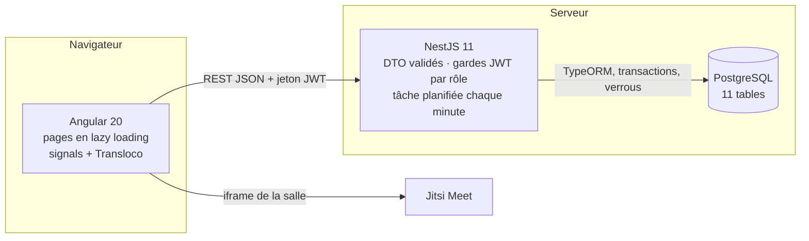

```
9rayti/
├── backend/                 API NestJS
│   ├── src/
│   │   ├── auth/            inscription, connexion, profil (JWT)
│   │   ├── catalog/         matières, tuteurs, recherche, heures libres, tarifs
│   │   ├── requests/        demandes de cours, machine à états, salle, avis
│   │   ├── credits/         crédits 9rayti (solde = somme des mouvements)
│   │   ├── exam-sessions/   sessions d'examen en groupe
│   │   ├── admin/           validation des tuteurs, activité
│   │   ├── seed/            données de démonstration
│   │   └── common/          rôles, gardes, argent (millimes)
│   ├── test/                tests e2e
│   └── scripts/local-db.mjs PostgreSQL embarqué
├── frontend/                application Angular
│   ├── src/app/
│   │   ├── core/            API typée, session (signals), intercepteur, gardes, langue
│   │   ├── shared/          composants et pipes (icônes, logo, montants, dates)
│   │   ├── pages/           11 pages chargées à la demande
│   │   └── demo/            faux serveur en mémoire pour la démo GitHub Pages
│   └── public/i18n/         fr.json · ar.json · en.json (286 clés chacun)
├── docs/                    audit d'accessibilité, captures
└── .github/workflows/       CI (tests) et déploiement de la démo
```

**Modèle de données** (issu de l'Objectif 2) : `compte`, `profil_tuteur`, `matiere`, `tarif` (un prix par tuteur et par matière), `creneau`, `demande`, `document`, `avis`, `mouvement_credit`, `session_examen`, `place`. Les montants sont stockés en **millimes entiers** (1 DT = 1000) pour éviter les erreurs d'arrondi.

**Mode démo** : la version GitHub Pages n'a pas de serveur. Un intercepteur HTTP (`frontend/src/app/demo`) remplace l'API par un petit serveur en mémoire qui applique les mêmes règles (12 h, remboursements, une réservation par heure…) sur des données capturées depuis la vraie API (`npm run demo:capture`). Le reste du code est identique.

---

## 5. Règles métier

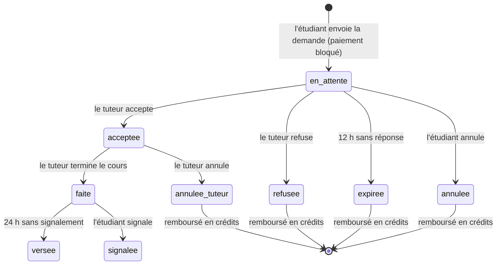

- Une fois la demande acceptée, l'étudiant ne peut plus annuler ; seul le tuteur le peut, et l'étudiant est remboursé.
- Remboursement **toujours en crédits 9rayti** (modèle choisi à l'Objectif 2), réutilisables pour un autre cours.
- Le **classement** (pertinence) combine la note et le **taux de réponse** : un tuteur qui refuse ou laisse expirer descend.
- La note publique n'apparaît qu'à partir de **5 avis** ; avant, le tuteur est « Nouveau ».
- Recherche par **matière générale** (Probabilités, Réseaux…), sans filtre par école : un étudiant de SUP'COM peut aider un étudiant d'ESPRIT.
- La machine à états est écrite en **fonctions pures** (`backend/src/requests/request-state.ts`) et testée à part.
- Toute action qui touche à l'argent ou à une heure libre se fait **dans une transaction avec verrou** (`SELECT … FOR UPDATE`) : deux demandes simultanées sur la même heure donnent une seule réservation et une erreur 409 claire.

---

## 6. API REST

Préfixe `/api`, JSON, jeton `Authorization: Bearer …`. Documentation interactive complète : **http://localhost:3000/api/docs** (Swagger).

| Domaine | Routes principales |
|---|---|
| Comptes | `POST /auth/register` · `POST /auth/login` · `GET /auth/me` · `PATCH /auth/me/lang` |
| Catalogue | `GET /subjects` · `GET /tutors?subject=&maxPrice=&minRating=&lang=&when=&sort=` · `GET /tutors/:id` |
| Demandes (étudiant) | `POST /requests` · `GET /requests/mine` · `POST /requests/:id/cancel` · `/report` · `/review` |
| Demandes (tuteur) | `GET /tutor/requests` · `GET /tutor/dashboard` · `POST /requests/:id/accept` · `/refuse` · `/tutor-cancel` · `/complete` |
| Espace tuteur | `GET/POST /tutor/slots` · `DELETE /tutor/slots/:id` · `GET/PUT /tutor/rates` |
| Salle de cours | `GET /classroom/:id` · `POST /classroom/:id/documents` |
| Crédits | `GET /credits/me` · `POST /credits/recharge` |
| Sessions d'examen | `GET /exam-sessions` · `GET /exam-sessions/mine` · `POST /exam-sessions/:id/book` |
| Admin | `GET /admin/overview` · `GET /admin/tutors/pending` · `POST /admin/tutors/:id/validate` |
| Santé | `GET /health` |

Les erreurs sont renvoyées en clair, en français, et affichées telles quelles (ex. « Solde de crédits insuffisant : recharge ou paie par carte. »). Tout champ inconnu dans une requête est refusé (`forbidNonWhitelisted`).

---

## 7. Qualité : tests, accessibilité, performance

| Aspect | Ce qui est fait |
|---|---|
| **Tests** | API : 17 tests unitaires + 5 tests e2e sur une vraie base PostgreSQL (authentification, rôles, double réservation, salle fermée avant acceptation, parcours complet). Front : 9 tests (pipes de langue, bascule RTL, heure de Tunis, compte à rebours, gardes de routes). Lancés à chaque push par **GitHub Actions** (`.github/workflows/ci.yml`). |
| **Accessibilité** | Audit **axe-core** (WCAG 2.1 A et AA) sur 11 pages : **0 violation** ([rapport](docs/accessibilite.md), script `frontend/scripts/a11y-audit.mjs`). Lien « Aller au contenu », focus visible partout, onglets en `tablist`, choix en `radiogroup`, dialogues natifs `<dialog>`, notifications `aria-live`, libellés sur tous les champs, `lang` et `dir` mis à jour, contrastes de la charte vérifiés, `prefers-reduced-motion` respecté. |
| **Responsive** | Conçu du mobile (390 px) au desktop : menu repliable, filtres repliables, grilles qui passent en une colonne, propriétés CSS logiques pour que l'arabe s'affiche en miroir sans feuille de style séparée. |
| **Multi-navigateurs** | Uniquement des API standard (fetch, `<dialog>`, Intl, CSS grid) supportées par Chrome, Edge, Firefox et Safari récents ; Angular cible les deux dernières versions de chaque navigateur. Testé sous Chromium. |
| **Performance** | Chaque page est chargée à la demande (lazy loading) : premier chargement **≈ 113 ko compressés** (421 ko bruts). Détection de changements `OnPush` partout, signals, icônes SVG inline (pas de police d'icônes), visio chargée seulement au clic, polices auto-hébergées. |
| **Qualité du code** | TypeScript strict des deux côtés, types partagés (`core/models.ts`), une responsabilité par module, DTO validés, ESLint et Prettier (API), messages de commit conventionnels. |
| **Sécurité** | Mots de passe hachés (bcrypt), JWT signé, rôles vérifiés côté serveur, participants vérifiés pour chaque demande et chaque salle, validation stricte des entrées, CORS limité au front. |

---

## 8. Méthode de travail

- **Une branche par fonctionnalité**, fusionnée par **pull request** : `feature/api`, `feature/front-socle`, `feature/front-catalogue`, `feature/front-espaces`, `feature/demo-pages`… ([historique des PR](https://github.com/iheb1234-afk/9rayti/pulls?q=is%3Apr)).
- **Commits clairs** au format *Conventional Commits* (`feat(api): …`, `feat(front): …`, `test: …`, `ci: …`), qui citent l'issue concernée.
- **Suivi des tâches** : 11 [issues](https://github.com/iheb1234-afk/9rayti/issues?q=is%3Aissue) étiquetées (`backend`, `frontend`, `qualité`, `docs`) dans le [jalon « Objectif 3 »](https://github.com/iheb1234-afk/9rayti/milestone/1), fermées automatiquement par les PR.
- **Intégration continue** : tests de l'API (avec un service PostgreSQL) et du front à chaque push ; la démo est republiée sur GitHub Pages à chaque fusion sur `main`.

---

## 9. Captures

| | |
|---|---|
| 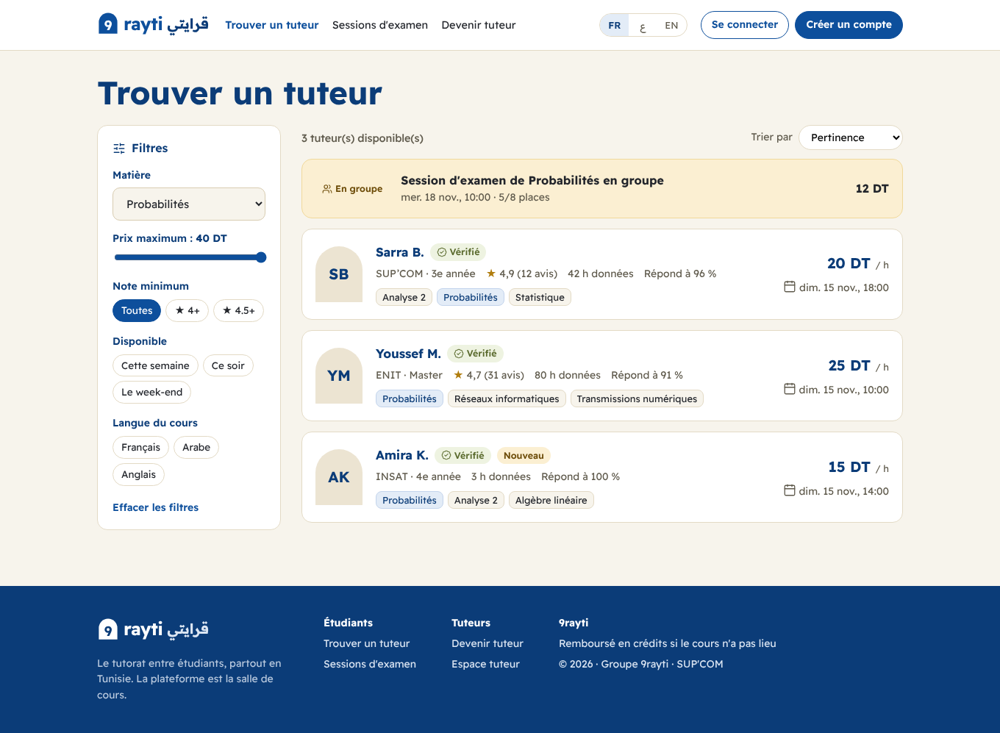 Recherche filtrable | 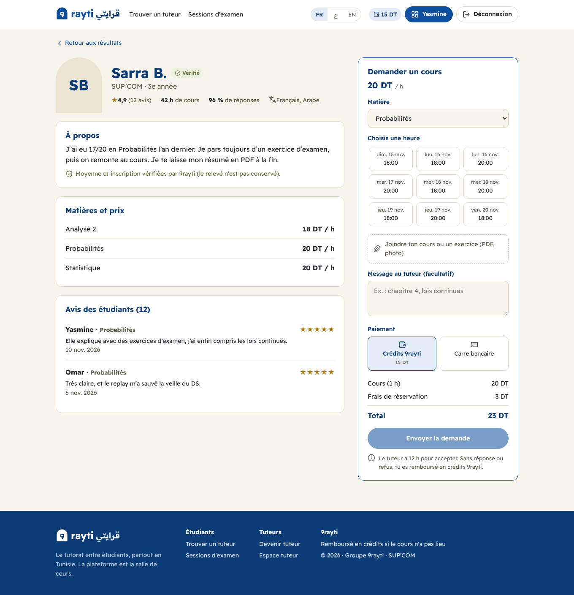 Profil et demande de cours |
| 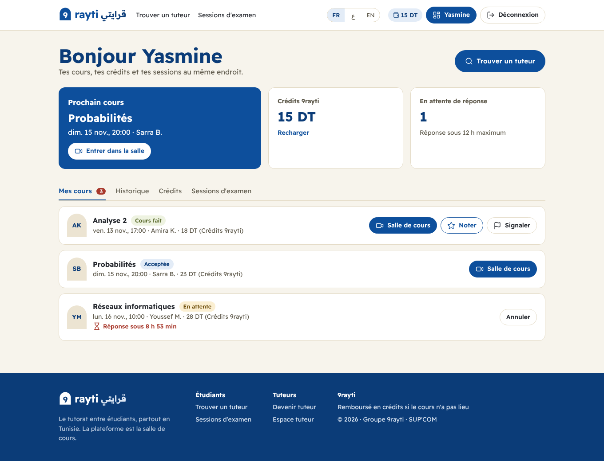 Espace étudiant | 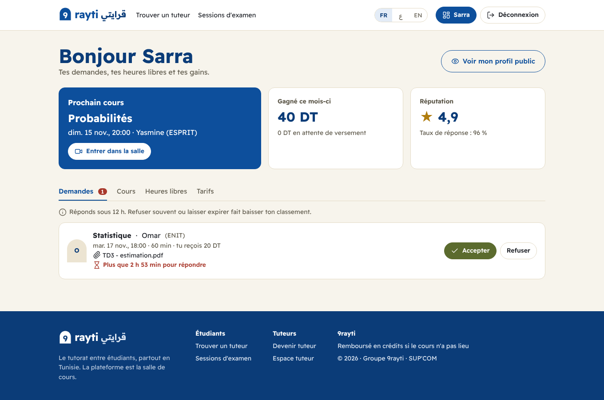 Espace tuteur |
| 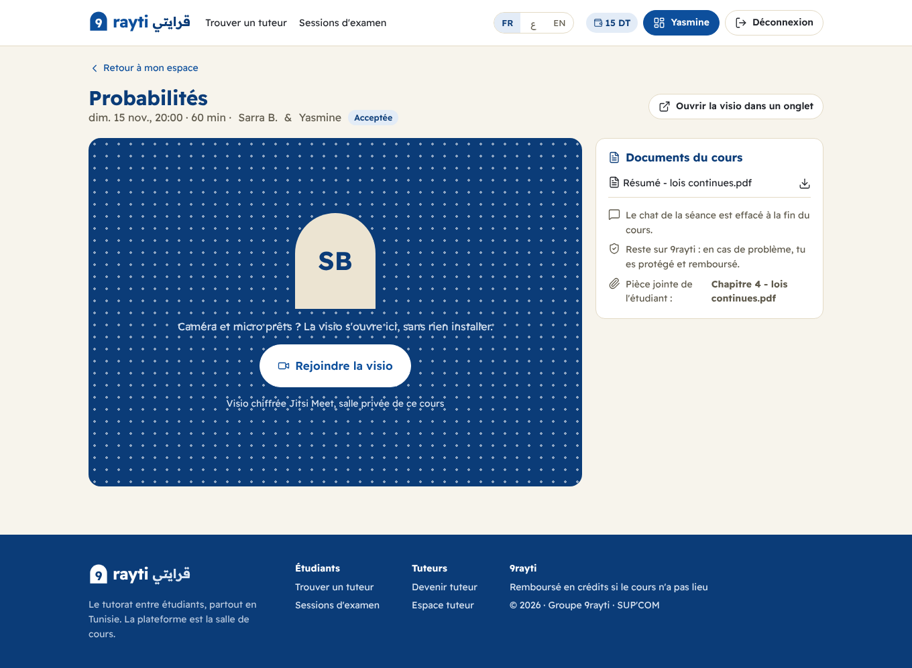 Salle de cours | 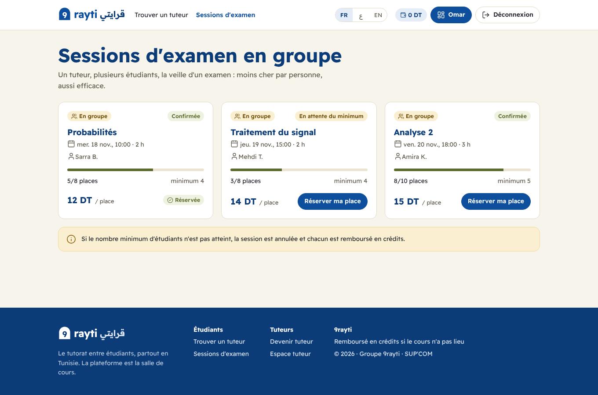 Sessions d'examen |
| 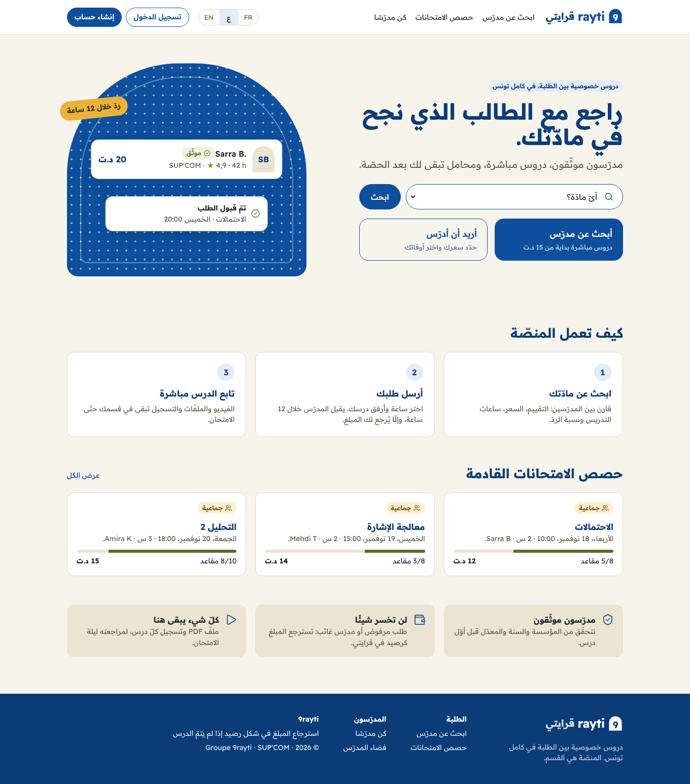 Arabe, de droite à gauche | 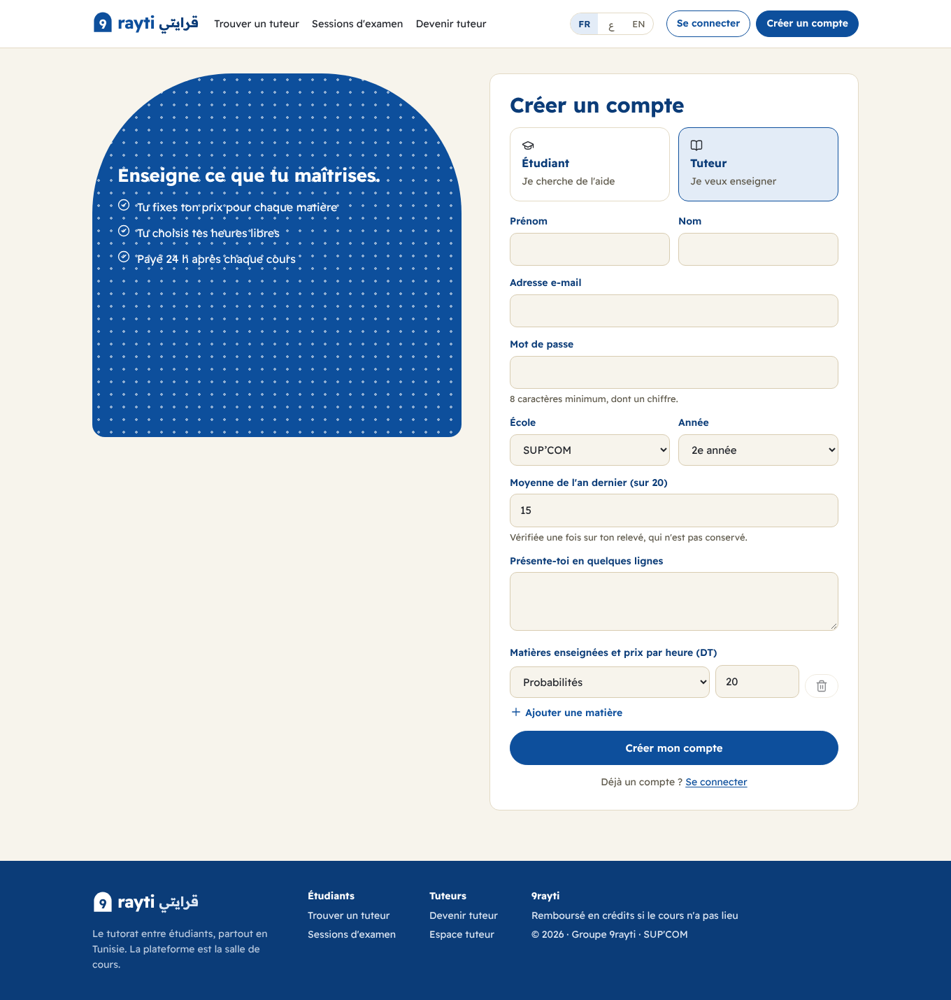 Inscription tuteur |

<p align="center">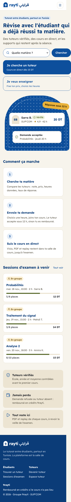 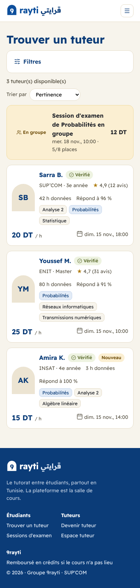</p>

---

## 10. Limites et suite

Ce qui est volontairement **simulé** dans ce prototype, et ce qu'il faudrait pour la production :

- **Paiement** : la carte et la recharge de crédits sont simulées → brancher un prestataire tunisien (Konnect, Flouci, paiement par carte via la SMT).
- **Pièce jointe** : seul le nom du fichier est enregistré → stockage d'objets (S3 ou équivalent) avec antivirus.
- **Vérification des tuteurs** : validée à la main par l'admin, relevé non stocké → téléversement temporaire du relevé, puis suppression.
- **Visio** : serveur public `meet.jit.si` (il peut demander à l'organisateur de se connecter) → instance Jitsi propre à 9rayti avec jetons JWT, enregistrement du replay automatique.
- **Schéma de la base** : synchronisé à partir des entités (`synchronize`) pour le prototype → migrations TypeORM versionnées.
- **Notifications** (e-mail, SMS) quand une demande arrive ou expire.

---

*Groupe 9rayti · Projet Web · SUP'COM · 2026–2027*
