# 9rayti · قرايتي

**Tutorat entre étudiants, partout en Tunisie.** Un étudiant qui a réussi une matière donne des cours en direct à d'autres étudiants, de son école ou d'ailleurs. La plateforme est la salle de cours : visio, PDF et replay restent au même endroit, ce qui protège l'étudiant (remboursé si le cours n'a pas lieu) et garde le tuteur sur 9rayti.

Projet Web, SUP'COM, encadré par Dr. Maroua Nouioua. **Objectif 4 : finalisation du frontend et optimisation** (après l'Objectif 3, implémentation).
Groupe 9rayti : Iheb Attia.

| | |
|---|---|
| **Démo en ligne** (sans installation, données simulées dans le navigateur) | https://iheb1234-afk.github.io/9rayti/ |
| **Code** | https://github.com/iheb1234-afk/9rayti |
| **Suivi des tâches** | [Issues](https://github.com/iheb1234-afk/9rayti/issues?q=is%3Aissue), jalons [« Objectif 3 »](https://github.com/iheb1234-afk/9rayti/milestone/1) et [« Objectif 4 »](https://github.com/iheb1234-afk/9rayti/milestone/2) |
| **Vidéo des animations** (42 s) | [docs/9rayti-animations.mp4](docs/9rayti-animations.mp4) |
| **Documentation de l'API** (une fois lancée) | http://localhost:3000/api/docs |

<p align="center"> 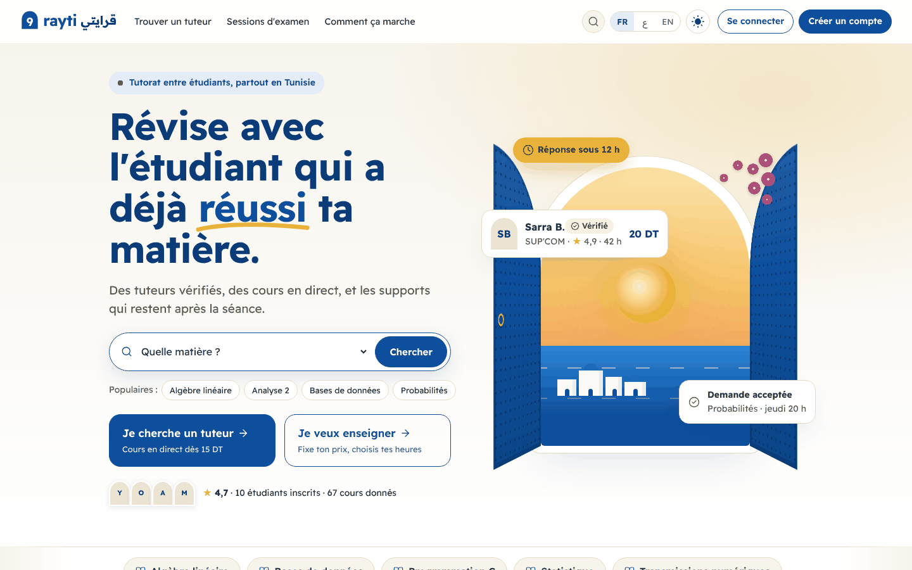</p>

---

## Sommaire

1. [Lancer le projet](#1-lancer-le-projet)
2. [Choix des frameworks](#2-choix-des-frameworks)
3. [Fonctionnalités développées](#3-fonctionnalités-développées) — et [ce qu'apporte l'Objectif 4](#objectif-4--ce-qui-a-changé)
4. [Architecture](#4-architecture)
5. [Règles métier](#5-règles-métier)
6. [API REST](#6-api-rest)
7. [Qualité : tests, accessibilité, performance](#7-qualité--tests-accessibilité-performance)
8. [Méthode de travail (Git, tâches)](#8-méthode-de-travail)
9. [Captures](#9-captures)
10. [Limites et suite](#10-limites-et-suite)

---

## 1. Lancer le projet

**Prérequis :** Node.js 20.19+ ou 22 (LTS) et npm. Rien d'autre : la base PostgreSQL est fournie par `npm run db:local` (pas besoin de Docker ni d'installer PostgreSQL).

```bash
git clone https://github.com/iheb1234-afk/9rayti.git
cd 9rayti
```

**Terminal 1 — base de données PostgreSQL** (port 5433)

```bash
cd backend
npm install
npm run db:local          # télécharge et démarre un PostgreSQL embarqué (dossier backend/.pgdata)
```

> Alternative : `docker compose up -d` à la racine, ou n'importe quel PostgreSQL en réglant `DATABASE_URL` (voir `backend/.env.example`).
> Sous Linux, `db:local` refuse de tourner en root (sécurité de PostgreSQL) : lancer avec un utilisateur normal.

**Terminal 2 — API NestJS** (port 3000)

```bash
cd backend
npm run start:dev         # crée les tables et les données de démonstration au premier démarrage
```

**Terminal 3 — application Angular** (port 4200)

```bash
cd frontend
npm install
npm start                 # puis ouvrir http://localhost:4200
```

**Comptes de démonstration** (mot de passe `demo1234` pour tous, aussi accessibles en un clic sur la page de connexion) :

| Rôle | E-mail | Pour voir |
|---|---|---|
| Étudiante | `yasmine@9rayti.tn` | demandes dans tous les états, crédits, salle de cours, avis |
| Étudiant | `omar@9rayti.tn` | paiement par carte, session d'examen réservée |
| Tutrice | `sarra@9rayti.tn` | demandes à accepter, cours, heures libres, gains |
| Tuteurs | `youssef@`, `amira@` (profil « Nouveau »), `mehdi@9rayti.tn` | |
| Tutrice en attente | `nour@9rayti.tn` | profil pas encore vérifié |
| Admin | `admin@9rayti.tn` | validation des tuteurs, activité |

Les dates des données de démonstration sont calculées à partir du jour du lancement : il y a toujours des cours à venir.

**Autres commandes**

```bash
cd backend  && npm test            # 37 tests unitaires (machine à états, délais, argent, classement, masquage)
cd backend  && npm run test:e2e    # 11 tests de bout en bout (base PostgreSQL lancée)
cd frontend && npm run test:ci     # 16 tests Angular (Chrome headless)
cd frontend && npm run build:demo  # build GitHub Pages (mode démo, sans serveur)
cd frontend && npm run e2e         # 10 parcours Playwright sur le build démo (Chromium, Firefox, WebKit, mobile)
```

---

## 2. Choix des frameworks

| Couche | Choix | Pourquoi |
|---|---|---|
| Front | **Angular 20** (standalone components, signals, nouveau control flow `@if/@for`) | Imposé par le cours, et adapté : application à plusieurs espaces (étudiant, tuteur, admin) avec formulaires, routes protégées et beaucoup d'état. Angular fournit tout cela de base (routeur, formulaires réactifs, HttpClient, intercepteurs) sans assembler dix bibliothèques. Les **signals** rendent l'état (session, filtres, onglets) simple et performant. |
| Traductions | **Transloco** | Changement de langue **à chaud** (sans recharger ni builder une version par langue, contrairement à l'i18n native d'Angular), indispensable pour basculer FR / AR / EN et le sens RTL depuis l'en-tête. |
| API | **NestJS 11** (TypeScript) | Même langage et mêmes idées qu'Angular (modules, décorateurs, injection de dépendances) : un seul langage pour tout le projet. Validation des entrées par DTO, gardes par rôle, tâches planifiées (expiration 12 h, versement 24 h) et documentation **Swagger** générée automatiquement. |
| Base | **PostgreSQL** + **TypeORM** | Base relationnelle SQL demandée depuis l'Objectif 1. Les **transactions et verrous** de PostgreSQL empêchent deux étudiants de réserver la même heure ; TypeORM traduit le modèle de données de l'Objectif 2 en entités. |
| Visio | **Jitsi Meet** (intégré en iframe) | Gratuit, chiffré, sans compte pour l'étudiant, une salle privée par cours générée par le serveur. |
| Style | **SCSS** + charte « Sidi Bou Saïd » | Charte de l'Objectif 2 (bleu des portes, chaux, olivier, soleil, police Readex Pro qui couvre l'arabe et le latin), sans framework CSS : pages légères et identité propre. |

Versions : Angular 20.3, NestJS 11, TypeORM 0.3, PostgreSQL 16+, TypeScript 5.9.

---

## 3. Fonctionnalités développées

**20 pages** (tout le plan du site de l'Objectif 2, les sous-pages des espaces étant des onglets), toutes branchées sur l'API, en **trois langues** (français, arabe en droite-à-gauche, anglais), en **thème clair ou sombre**, du mobile au grand écran.

### Objectif 4 : ce qui a changé

| | |
|---|---|
| **Pages ajoutées** | Comment ça marche (parcours étudiant / tuteur avec téléphone animé), Devenir tuteur (simulateur de gains), À propos, Contact (formulaire enregistré, traité par l'admin), CGU (sommaire qui suit la lecture), détail d'une session d'examen, Messages, Notifications, Mon profil, 404 animée. |
| **Fonctionnalités** | Messagerie étudiant ↔ tuteur avec **coordonnées masquées** (numéros, e-mails, liens, réseaux, chiffres arabes), **notifications en direct** (Server-Sent Events) et du navigateur, **favoris**, **recherche rapide Ctrl K**, **partage du profil** (lien, WhatsApp, QR code), photo de profil, compte rendu du tuteur en fin de cours, sessions d'examen créées par le tuteur, **revenus** sur 12 semaines, administration complète (signalements à trancher, cours et paiements paginés, matières, messages de contact). |
| **Composants réutilisables** | 20 composants (`components/`), 5 directives d'animation (`directives/`), 4 pipes, services par domaine (`core/`) ; une page = un dossier `.ts` / `.html` / `.scss`. |
| **Animations** | Porte de Sidi Bou Saïd qui s'ouvre (CSS), pétales de bougainvillier, parallaxe des cartes, titres lettre par lettre et effets au défilement (GSAP, chargé seulement au premier défilement), démo du masquage des numéros, transitions entre pages et avatar qui « voyage » de la carte au profil (View Transitions), changement de thème en cercle, confettis à la réservation, boutons magnétiques, cartes en relief. Tout respecte `prefers-reduced-motion`. |
| **Performance** | Sections de l'accueil différées (`@defer`), GSAP et confettis chargés à la demande, Angular sans zone.js, une seule langue téléchargée, démo hors-ligne chargée à part. Mesures Lighthouse avant / après : [docs/performance.md](docs/performance.md). |
| **Tests** | 16 tests unitaires front, 37 unitaires et 11 e2e côté API, et **10 parcours Playwright** joués à chaque push sur **Chromium, Firefox, WebKit (Safari) et un téléphone**. |

<p align="center">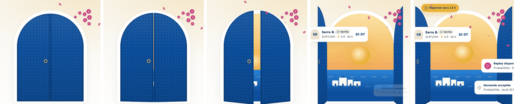</p>
<p align="center">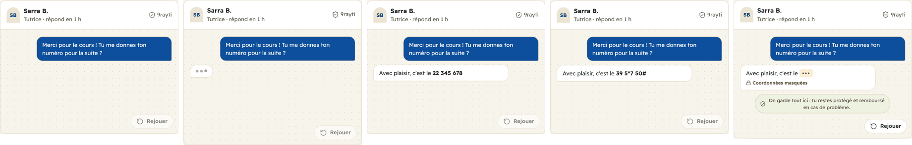</p>

### Visiteur
- **Accueil** : recherche par matière, sessions d'examen à venir (données réelles), engagements de la plateforme.
- **Recherche des tuteurs** : filtres matière, prix maximum, note minimum, disponibilité (ce soir, cette semaine, week-end), langue du cours ; tri pertinence / prix / note. Les filtres vivent **dans l'URL** (une recherche se partage et survit au rechargement).
- **Profil du tuteur** : note (affichée à partir de 5 avis, sinon badge « Nouveau »), heures données, taux de réponse, langues, matières et prix, avis des étudiants, heures libres.
- **Sessions d'examen en groupe** : places prises / minimum / maximum, prix par place.
- **Inscription** étudiant ou tuteur (comptes séparés, un rôle chacun) et **connexion** commune.
- **Comment ça marche**, **Devenir tuteur** (simulateur de gains), **À propos**, **Contact**, **CGU**, page **404**.

### Étudiant
- **Demande de cours** depuis le profil : heure libre, pièce jointe, message, paiement par **crédits 9rayti** ou carte (simulée), récapitulatif avec les **3 DT de frais de réservation**.
- **Mon espace** : prochain cours, solde de crédits, demandes en attente avec **compte à rebours des 12 h**, historique, remboursements affichés, annulation tant que le tuteur n'a pas répondu.
- **Noter** un cours terminé, **signaler** un problème dans les 24 h (le versement au tuteur est suspendu).
- **Crédits** : solde, mouvements (recharge, paiement, remboursement), recharge simulée.
- **Réserver une place** dans une session d'examen.
- **Favoris**, **messages** aux tuteurs (coordonnées masquées), **notifications** en direct, **profil** (photo, informations, mot de passe, langue, thème).

### Tuteur
- **Demandes** à accepter ou refuser (délai restant, pièce jointe, message, montant reçu).
- **Cours** : entrer dans la salle, terminer le cours (déclenche le versement à 24 h), annuler (l'étudiant est remboursé).
- **Heures libres** : semaine visuelle, ajout et suppression.
- **Tarifs** : un prix par matière.
- Gains du mois, versements en attente, réputation ; bandeau tant que le profil n'est pas vérifié.
- **Sessions d'examen** : création (minimum et maximum d'inscrits, prix par place, programme) et liste des inscrits.
- **Revenus** : graphique des 12 dernières semaines (versé / en attente), historique des paiements.
- **Compte rendu** laissé à l'étudiant en terminant le cours ; partage du profil par lien ou QR code.

### Salle de cours (étudiant et tuteur)
- Ouverte seulement aux deux participants, une fois la demande acceptée.
- **Visio Jitsi intégrée** (chargée au clic : pas de caméra ni de script tiers tant qu'on n'a pas rejoint).
- **Documents du cours** : le tuteur partage PDF et replay, ils restent jusqu'à l'examen.

### Administration
- Valider les tuteurs (une seule fois ; le relevé de notes n'est pas conservé), activité par état et volume.
- **Trancher les signalements** (rembourser l'étudiant ou payer le tuteur, avec une note visible des deux), **cours et paiements** (filtre par état, recherche, pagination), **matières** (ajout et traduction), **messages de contact**.

---

## 4. Architecture

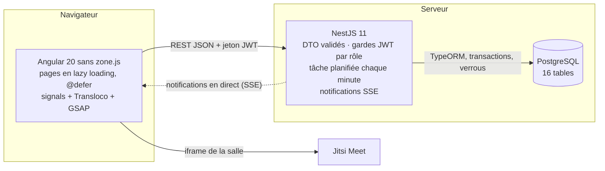

```
9rayti/
├── backend/                 API NestJS
│   ├── src/
│   │   ├── auth/            inscription, connexion, profil (JWT)
│   │   ├── catalog/         matières, tuteurs, recherche, heures libres, tarifs
│   │   ├── requests/        demandes de cours, machine à états, salle, avis
│   │   ├── credits/         crédits 9rayti (solde = somme des mouvements)
│   │   ├── exam-sessions/   sessions d'examen en groupe
│   │   ├── messages/        messagerie et masquage des coordonnées
│   │   ├── notifications/   notifications stockées + flux en direct (SSE)
│   │   ├── favorites/       tuteurs favoris
│   │   ├── contact/         formulaire de contact
│   │   ├── users/           photos de profil
│   │   ├── admin/           validation, signalements, paiements, matières, contact
│   │   ├── seed/            données de démonstration
│   │   └── common/          rôles, gardes, argent (millimes)
│   ├── test/                tests e2e
│   └── scripts/local-db.mjs PostgreSQL embarqué
├── frontend/                application Angular
│   ├── src/app/
│   │   ├── core/            API typée, session, gardes, langue, thème, notifications, animations
│   │   ├── components/      20 composants réutilisables (onglets, fenêtre modale, graphique…)
│   │   ├── directives/      apparition, relief, bouton magnétique, compteur, titre animé
│   │   ├── pipes/           montants, dates (heure de Tunis), matières, nombres
│   │   ├── layout/          en-tête, pied de page, notifications à l'écran
│   │   ├── pages/           20 pages chargées à la demande
│   │   └── demo/            faux serveur en mémoire pour la démo GitHub Pages (chargé à part)
│   ├── e2e/                 parcours Playwright
│   └── public/i18n/         fr.json · ar.json · en.json (768 clés chacun)
├── docs/                    performance, accessibilité, recherche, captures, vidéo
└── .github/workflows/       CI (tests) et déploiement de la démo
```

**Modèle de données** (issu de l'Objectif 2) : `compte`, `profil_tuteur`, `matiere`, `tarif` (un prix par tuteur et par matière), `creneau`, `demande`, `document`, `avis`, `mouvement_credit`, `session_examen`, `place`. Les montants sont stockés en **millimes entiers** (1 DT = 1000) pour éviter les erreurs d'arrondi.

**Mode démo** : la version GitHub Pages n'a pas de serveur. Un intercepteur HTTP (`frontend/src/app/demo`) remplace l'API par un petit serveur en mémoire qui applique les mêmes règles (12 h, remboursements, une réservation par heure…) sur des données capturées depuis la vraie API (`npm run demo:capture`). Le reste du code est identique.

---

## 5. Règles métier

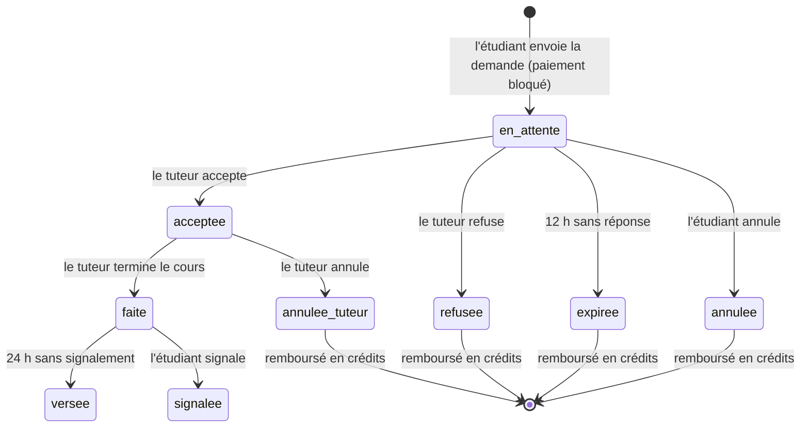

- Une fois la demande acceptée, l'étudiant ne peut plus annuler ; seul le tuteur le peut, et l'étudiant est remboursé.
- Remboursement **toujours en crédits 9rayti** (modèle choisi à l'Objectif 2), réutilisables pour un autre cours.
- Le **classement** (pertinence) combine la note et le **taux de réponse** : un tuteur qui refuse ou laisse expirer descend.
- La note publique n'apparaît qu'à partir de **5 avis** ; avant, le tuteur est « Nouveau ».
- Recherche par **matière générale** (Probabilités, Réseaux…), sans filtre par école : un étudiant de SUP'COM peut aider un étudiant d'ESPRIT.
- La machine à états est écrite en **fonctions pures** (`backend/src/requests/request-state.ts`) et testée à part.
- Toute action qui touche à l'argent ou à une heure libre se fait **dans une transaction avec verrou** (`SELECT … FOR UPDATE`) : deux demandes simultanées sur la même heure donnent une seule réservation et une erreur 409 claire.

---

## 6. API REST

Préfixe `/api`, JSON, jeton `Authorization: Bearer …`. Documentation interactive complète : **http://localhost:3000/api/docs** (Swagger).

| Domaine | Routes principales |
|---|---|
| Comptes | `POST /auth/register` · `POST /auth/login` · `GET /auth/me` · `PATCH /auth/me/lang` |
| Catalogue | `GET /subjects` · `GET /tutors?subject=&maxPrice=&minRating=&lang=&when=&sort=` · `GET /tutors/:id` |
| Demandes (étudiant) | `POST /requests` · `GET /requests/mine` · `POST /requests/:id/cancel` · `/report` · `/review` |
| Demandes (tuteur) | `GET /tutor/requests` · `GET /tutor/dashboard` · `POST /requests/:id/accept` · `/refuse` · `/tutor-cancel` · `/complete` |
| Espace tuteur | `GET/POST /tutor/slots` · `DELETE /tutor/slots/:id` · `GET/PUT /tutor/rates` |
| Salle de cours | `GET /classroom/:id` · `POST /classroom/:id/documents` |
| Crédits | `GET /credits/me` · `POST /credits/recharge` |
| Sessions d'examen | `GET /exam-sessions` · `GET /exam-sessions/mine` · `POST /exam-sessions/:id/book` |
| Admin | `GET /admin/overview` · `GET /admin/tutors/pending` · `POST /admin/tutors/:id/validate` |
| Santé | `GET /health` |

Les erreurs sont renvoyées en clair, en français, et affichées telles quelles (ex. « Solde de crédits insuffisant : recharge ou paie par carte. »). Tout champ inconnu dans une requête est refusé (`forbidNonWhitelisted`).

---

## 7. Qualité : tests, accessibilité, performance

| Aspect | Ce qui est fait |
|---|---|
| **Tests** | API : **37 tests unitaires** (règles d'état, classement bayésien, masquage des coordonnées…) + **11 tests e2e** sur une vraie base PostgreSQL. Front : **16 tests unitaires** (pipes, gardes, onglets au clavier, masquage) et **10 parcours Playwright** (réservation, messagerie masquée, tuteur, admin, contact, arabe, thème, Ctrl K, menu mobile). Tout est lancé à chaque push par **GitHub Actions**. |
| **Accessibilité** | Audit **axe-core** (WCAG 2.1 A et AA) sur **26 vues**, chaque page parcourue jusqu'en bas : **0 violation** ([rapport](docs/accessibilite.md), script `frontend/scripts/a11y-audit.mjs`) ; Lighthouse accessibilité 100. Lien « Aller au contenu », focus visible, onglets `tablist` pilotables au clavier (flèches inversées en arabe), dialogues natifs `<dialog>`, recherche rapide en `combobox`, notifications `aria-live`, titres animés lus en entier (`aria-label`), contrastes vérifiés en clair et en sombre, `prefers-reduced-motion` respecté par toutes les animations. Règles d'accessibilité d'angular-eslint actives. |
| **Responsive** | Du téléphone (360 px) au grand écran : menu plein écran animé, en-tête qui se replie selon la place, grilles qui passent en une colonne, onglets qui défilent, propriétés CSS logiques pour l'arabe. Vérifié par un script : **23 pages × 5 largeurs (360 à 1440 px), aucun débordement horizontal** ([rapport](docs/responsive.md), script `frontend/scripts/responsive-check.mjs`). |
| **Multi-navigateurs** | Parcours Playwright exécutés en CI sur **Chromium, Firefox, WebKit (moteur de Safari)** et un **téléphone Android émulé** (`frontend/playwright.config.ts`). Les effets récents (View Transitions) ont un repli simple quand le navigateur ne les connaît pas. |
| **Performance** | Lighthouse, médiane de plusieurs passages (avant → après) : accueil mobile **57 → 80**, ordinateur **90 → 99** ; recherche mobile **70 → 88** ; sessions mobile **68 → 90** ; CLS de l'accueil **0,677 → 0** ([détails](docs/performance.md)). Lazy loading de chaque page, sections de l'accueil en `@defer`, GSAP chargé au premier défilement, Angular **sans zone.js**, `OnPush` et signals partout, polices auto-hébergées, une seule langue téléchargée, mode démo séparé du site. |
| **Qualité du code** | TypeScript strict des deux côtés, types partagés (`core/models.ts`), une responsabilité par module, DTO validés, ESLint et Prettier (API), messages de commit conventionnels. |
| **Sécurité** | Mots de passe hachés (bcrypt), JWT signé, rôles vérifiés côté serveur, participants vérifiés pour chaque demande et chaque salle, validation stricte des entrées, CORS limité au front. |

---

## 8. Méthode de travail

- **Une branche par fonctionnalité**, fusionnée par **pull request** : `feature/api`, `feature/front-socle`, `feature/front-catalogue`, `feature/front-espaces`, `feature/demo-pages`… ([historique des PR](https://github.com/iheb1234-afk/9rayti/pulls?q=is%3Apr)).
- **Commits clairs** au format *Conventional Commits* (`feat(api): …`, `feat(front): …`, `test: …`, `ci: …`), qui citent l'issue concernée.
- **Suivi des tâches** : [issues](https://github.com/iheb1234-afk/9rayti/issues?q=is%3Aissue) étiquetées (`backend`, `frontend`, `qualité`, `docs`) dans les jalons [« Objectif 3 »](https://github.com/iheb1234-afk/9rayti/milestone/1) et [« Objectif 4 »](https://github.com/iheb1234-afk/9rayti/milestone/2), fermées automatiquement par les PR.
- **Recherche de projets similaires** avant l'Objectif 4 : 11 dépôts GitHub de tutorat étudiés, ce qu'on a repris et ce qu'on fait mieux ([docs/recherche-projets-similaires.md](docs/recherche-projets-similaires.md)).
- **Intégration continue** : ESLint, Prettier, tests de l'API (avec un service PostgreSQL), tests du front et parcours Playwright sur trois moteurs à chaque push ; la démo est republiée sur GitHub Pages à chaque fusion sur `main`.

---

## 9. Captures

| | |
|---|---|
| 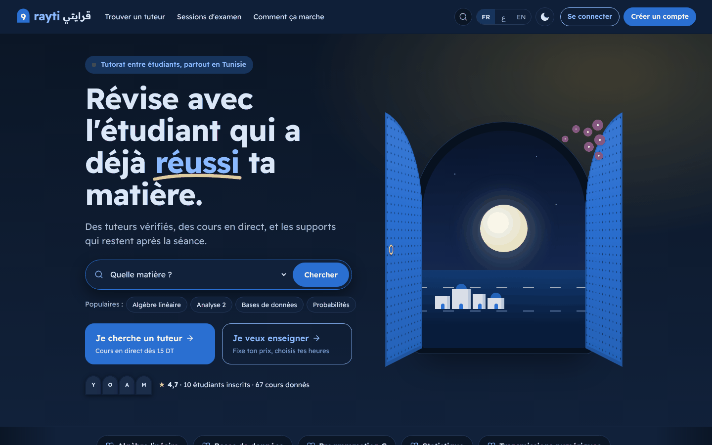 Accueil, thème sombre | 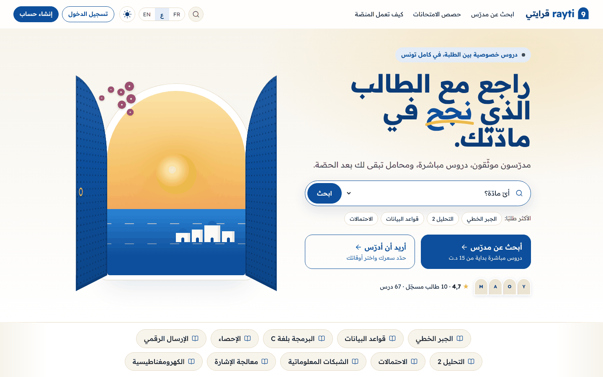 Arabe, de droite à gauche |
| 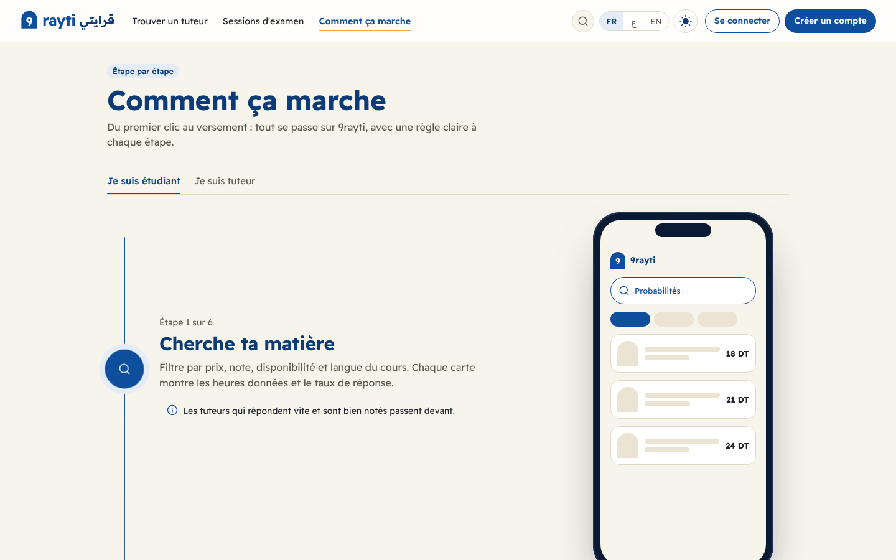 Comment ça marche | 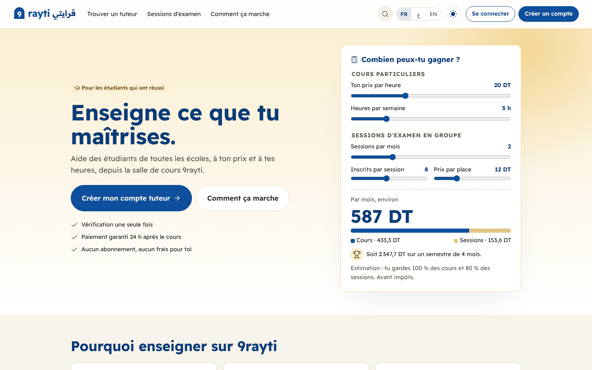 Devenir tuteur, simulateur |
| 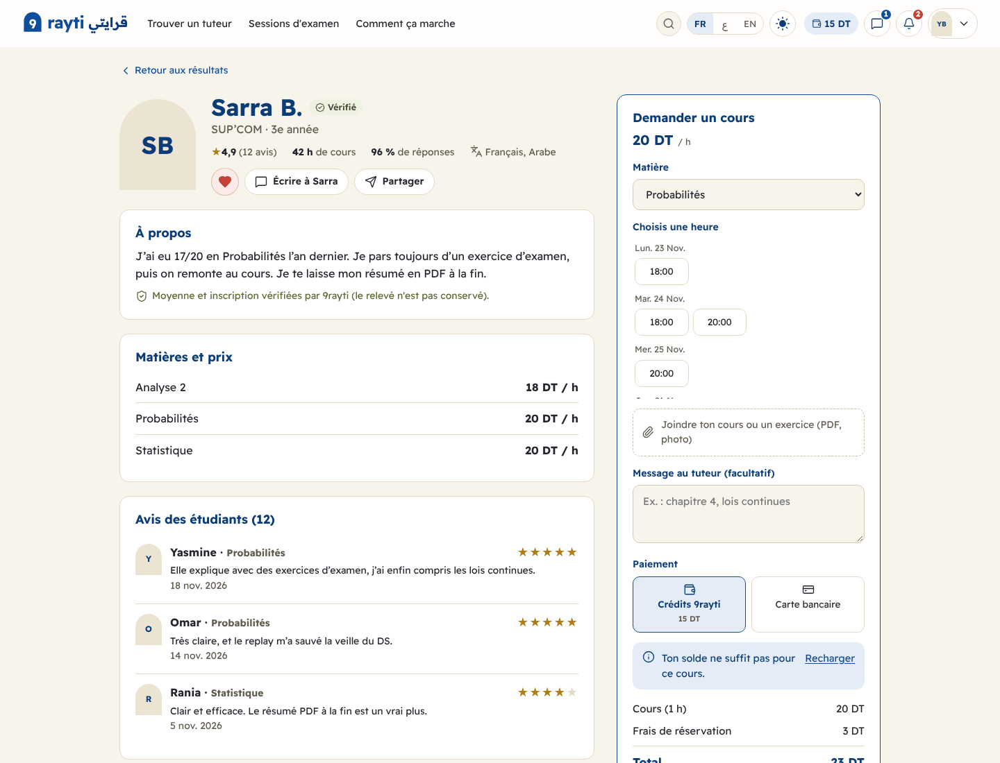 Profil et demande de cours | 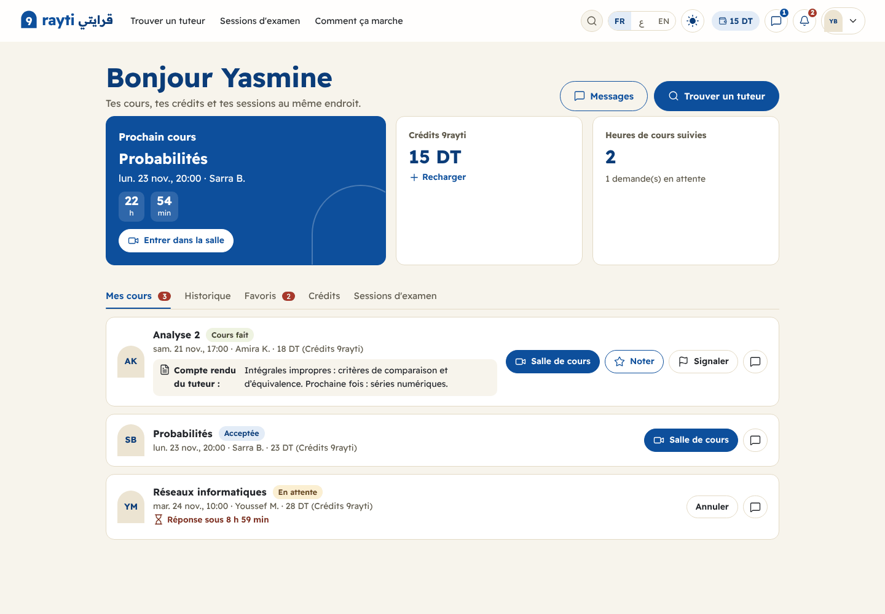 Espace étudiant |
| 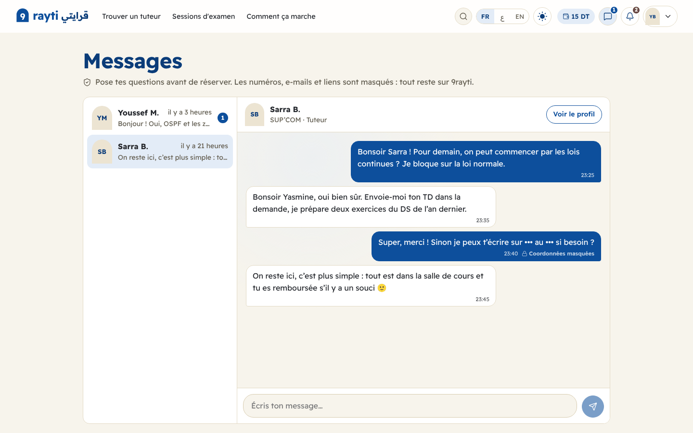 Messages, numéro masqué | 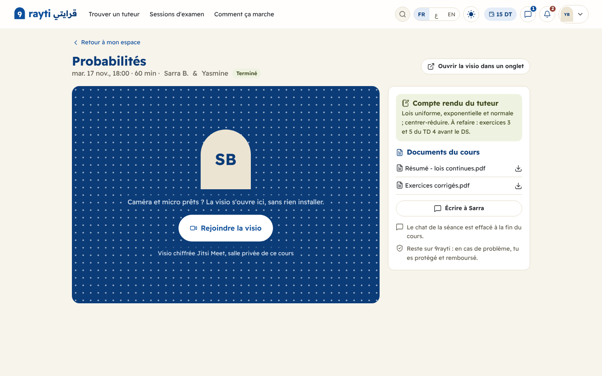 Salle de cours et compte rendu |
| 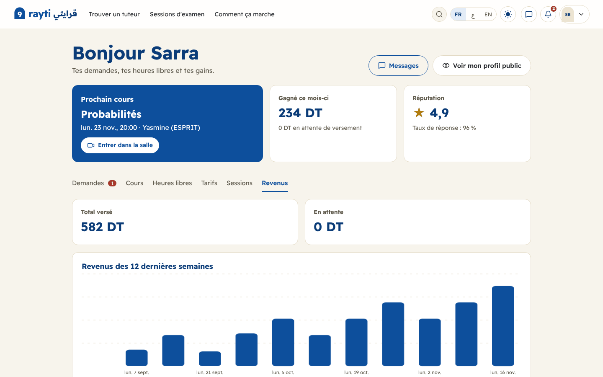 Revenus du tuteur | 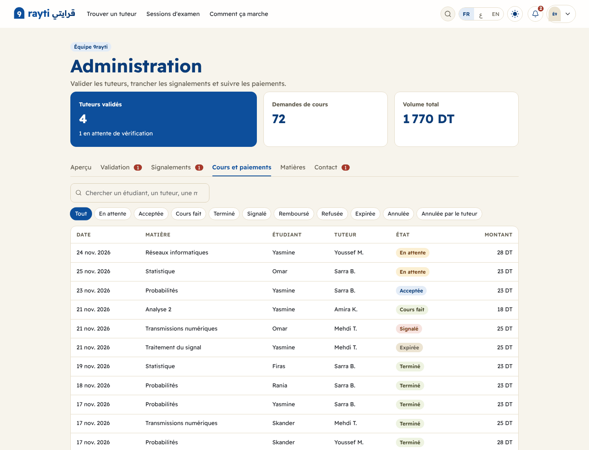 Administration : cours et paiements |
| 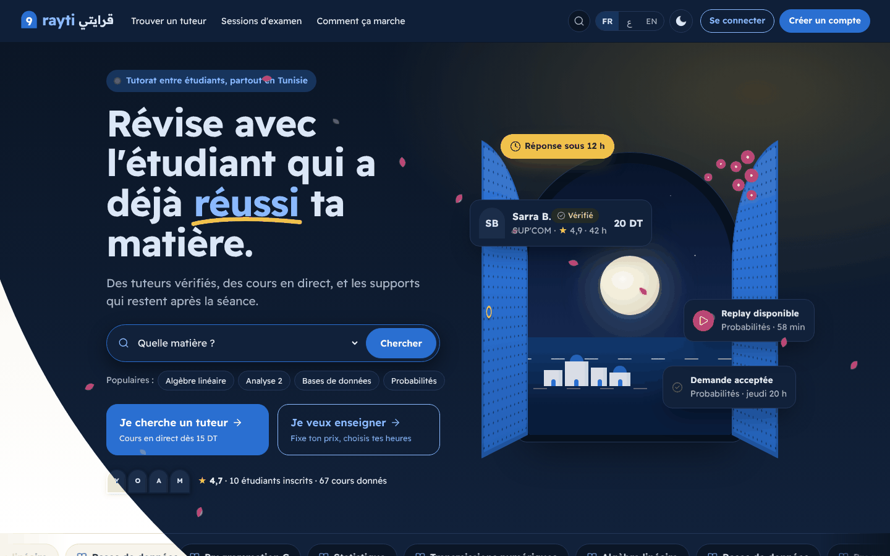 Changement de thème en cercle | 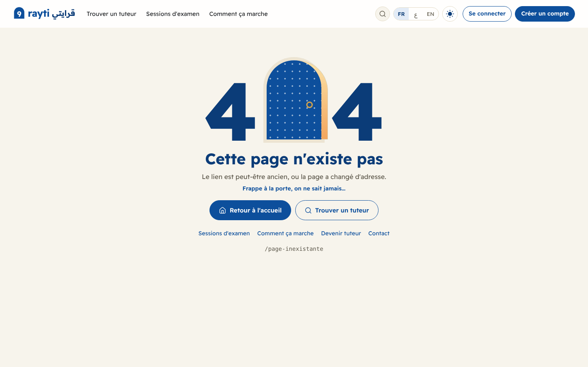 Page 404 |

<p align="center">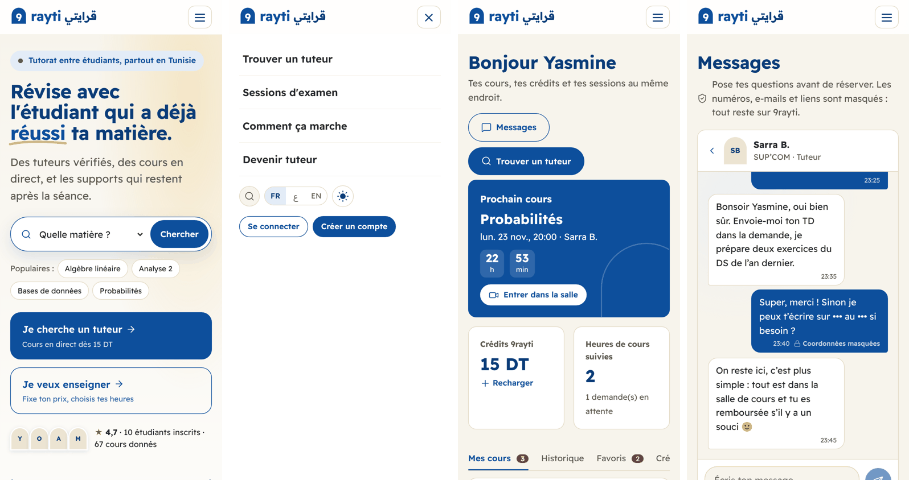</p>

---

## 10. Limites et suite

Ce qui est volontairement **simulé** dans ce prototype, et ce qu'il faudrait pour la production :

- **Paiement** : la carte et la recharge de crédits sont simulées → brancher un prestataire tunisien (Konnect, Flouci, paiement par carte via la SMT).
- **Pièce jointe** : seul le nom du fichier est enregistré → stockage d'objets (S3 ou équivalent) avec antivirus.
- **Vérification des tuteurs** : validée à la main par l'admin, relevé non stocké → téléversement temporaire du relevé, puis suppression.
- **Visio** : serveur public `meet.jit.si` (il peut demander à l'organisateur de se connecter) → instance Jitsi propre à 9rayti avec jetons JWT, enregistrement du replay automatique.
- **Schéma de la base** : synchronisé à partir des entités (`synchronize`) pour le prototype → migrations TypeORM versionnées.
- **Notifications** : en direct dans le site et dans le navigateur → ajouter l'e-mail et le SMS.
- **Rendu côté serveur** (Angular SSR) pour un premier affichage encore plus rapide sur mobile.

---

*Groupe 9rayti · Projet Web · SUP'COM · 2026–2027*
